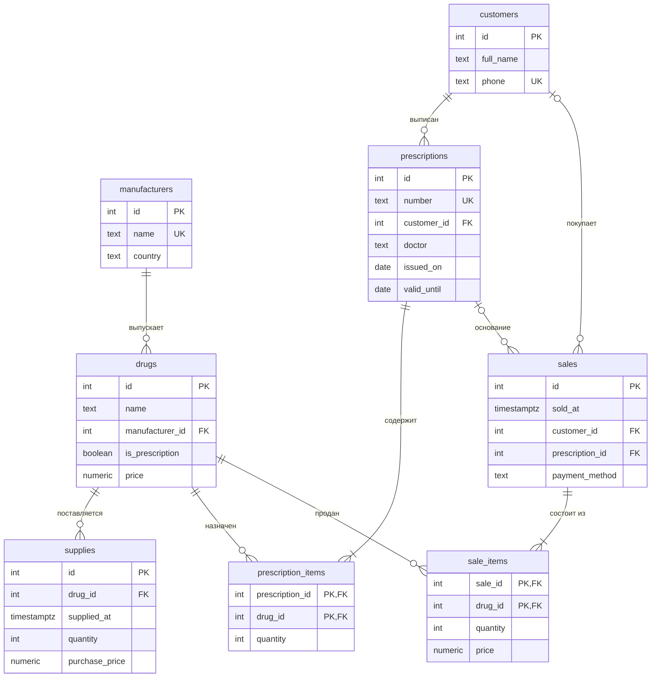

# Аптека

Тема № 17: **Аптека**. База хранит каталог препаратов и их производителей, поставки на склад, рецепты от врачей и продажи. Нужна аптеке, чтобы вести учёт продаж и не продавать рецептурные препараты без рецепта.

| | |
| --- | --- |
| Главная таблица | `sales` (продажи) |
| Связь N:M | `prescriptions` и `drugs` через `prescription_items` |
| Бизнес-правило | Рецептурный препарат продаётся только по рецепту |
| СУБД | PostgreSQL 17 в Docker |

## О базе

Это база одной аптеки. С ней работают:

- **фармацевт на кассе**: находит препарат, оформляет продажу, для рецептурного препарата проверяет рецепт покупателя;
- **заведующий аптекой**: принимает поставки, следит за ценами и остатками, смотрит, что и сколько продано.

Как это выглядит в жизни. Врач выписывает пациенту рецепт с несколькими препаратами. Пациент приходит в аптеку, фармацевт находит рецепт по номеру и продаёт препараты из него. Обычные препараты, например обезболивающие или витамины, продаются без рецепта и даже без указания покупателя. Каждая продажа это чек из одной или нескольких позиций, и в позиции запоминается цена на момент продажи. Препараты приходят на склад поставками от производителей.

Главное правило: **рецептурный препарат продаётся только по рецепту, в котором он есть**. Поэтому у препарата хранится признак «рецептурный», а у продажи ссылка на рецепт.

## Таблицы

| Таблица | Что хранит | Основные колонки |
| --- | --- | --- |
| `manufacturers` | Производители препаратов | название (уникальное), страна |
| `drugs` | Каталог препаратов. Одна строка это позиция каталога («Нурофен 200 мг №10»), а не отдельная упаковка | название, производитель, признак «рецептурный», текущая цена |
| `customers` | Покупатели. Они же пациенты, которым выписывают рецепты | ФИО, телефон (уникальный) |
| `prescriptions` | Рецепты от врачей | номер (уникальный), пациент, врач, дата выписки, срок действия |
| `prescription_items` | Состав рецепта. Связующая таблица N:M: в рецепте несколько препаратов, препарат входит во много рецептов | рецепт, препарат, количество упаковок |
| `supplies` | Поставки препаратов на склад | препарат, дата и время, количество, закупочная цена |
| `sales` | Продажи (чеки). Покупатель и рецепт указываются, только если они есть | дата и время, покупатель, рецепт, способ оплаты |
| `sale_items` | Позиции чека: какие препараты и сколько продали. Связь продажа ↔ препарат | чек, препарат, количество, цена на момент продажи |

## Задания курса

Правила курса, установка и порядок сдачи: [docs/README.md](docs/README.md).

| Лаба | Задание |
| --- | --- |
| 1. Модель данных и схема | [docs/lab-1.md](docs/lab-1.md) |
| 2. Запросы | [docs/lab-2.md](docs/lab-2.md) |
| 3. Логика в базе | [docs/lab-3.md](docs/lab-3.md) |
| 4. Транзакции и доступ | [docs/lab-4.md](docs/lab-4.md) |
| 5. Производительность | [docs/lab-5.md](docs/lab-5.md) |
| Витрина к защите | [docs/showcase.md](docs/showcase.md) |

## Как запустить

```bash
cp .env.example .env          # пароли и порт
docker compose up -d          # при первом запуске выполняются скрипты из db/
dbcheck run demo/lab1.sql     # сценарий лабы 1
```

Работа с базой: `docker compose exec db psql -U postgres -d app`. Сценарии выполняются в `psql` командой `\i /demo/lab1.sql`.

После изменения скриптов в `db/` базу нужно пересоздать: `docker compose down -v && docker compose up -d`.

## ER-диаграмма



Связующие таблицы: `prescription_items` (рецепт ↔ препарат) и `sale_items` (продажа ↔ препарат). В обеих первичный ключ составной из двух внешних ключей, поэтому один препарат нельзя записать в один рецепт или чек дважды.

`sales.customer_id` и `sales.prescription_id` могут быть пустыми: безрецептурные препараты покупают анонимно и без рецепта.

## Ограничения

| Ограничение | Таблица и колонки | Зачем |
| --- | --- | --- |
| `UNIQUE` | `manufacturers.name` | Один производитель записан один раз |
| `UNIQUE` | `drugs (name, manufacturer_id)` | Один и тот же препарат производителя не заводится дважды |
| `UNIQUE` | `customers.phone` | По телефону однозначно находим покупателя |
| `UNIQUE` | `prescriptions.number` | Двух рецептов с одним номером не бывает |
| `CHECK` | `drugs.price > 0`, `supplies.purchase_price > 0` | Цена не может быть нулевой или отрицательной |
| `CHECK` | `quantity > 0` в `prescription_items`, `supplies`, `sale_items` | Нельзя назначить, привезти или продать 0 упаковок |
| `CHECK` | `prescriptions: valid_until >= issued_on` | Рецепт не может истечь раньше, чем выписан |
| `CHECK` | `sales.payment_method IN ('cash', 'card')` | Только два способа оплаты |
| `CHECK` | `sale_items.price >= 0` | Цена в чеке не отрицательная |

Бизнес-правило «рецептурный препарат только по рецепту» затрагивает несколько таблиц, поэтому одним `CHECK` его не выразить. Для него в схеме есть `drugs.is_prescription` и `sales.prescription_id`, саму проверку делает триггер в лабе 3.

## Нормализация

Если хранить всё в одной таблице, продажа выглядела бы так:

| дата | покупатель | телефон | препарат | производитель | страна | цена | № рецепта | врач |
| --- | --- | --- | --- | --- | --- | --- | --- | --- |
| 01.10 | Иванов П. С. | +79001112233 | Амоксициллин 500 мг | Hemofarm | Сербия | 160 | Р-2026-0001 | Орлова Т. В. |
| 01.10 | Иванов П. С. | +79001112233 | Цетиризин 10 мг | Teva | Израиль | 150 | Р-2026-0001 | Орлова Т. В. |
| 08.10 | Васильева Е. П. | +79006667788 | Амоксициллин 500 мг | Hemofarm | Сербия | 155 | Р-2026-0006 | Захарова Н. Ю. |

Где повтор:

- производитель и его страна копируются в каждую продажу препарата;
- имя и телефон покупателя повторяются в каждой его покупке;
- номер рецепта и врач повторяются на каждой позиции чека.

Из-за этого при смене телефона пришлось бы править много строк, а удаление единственной продажи препарата удалило бы и сведения о его производителе.

Как разбито:

- **1НФ.** В ячейке одно значение. Несколько препаратов в одном чеке это несколько строк в `sale_items`, а не список через запятую.
- **2НФ.** В `sale_items` ключ `(sale_id, drug_id)`. Название препарата зависит только от `drug_id`, поэтому вынесено в `drugs`. Дата и покупатель зависят только от `sale_id` и вынесены в `sales`.
- **3НФ.** Страна зависит от производителя, а не от препарата (продажа → препарат → производитель → страна), поэтому она в `manufacturers`. Врач и даты зависят от рецепта, поэтому они в `prescriptions`, а продажа ссылается на рецепт.

Цена хранится в двух местах, но это не повтор: `drugs.price` текущая цена по прайсу, `sale_items.price` цена, по которой продали тогда. При изменении прайса старые чеки остаются верными.

## Типы данных

| Данные | Тип | Почему |
| --- | --- | --- |
| Цены | `numeric(10, 2)` | Точная десятичная арифметика, `float` даёт ошибки округления |
| Время продажи и поставки | `timestamptz` | Момент времени с часовым поясом |
| Даты рецепта | `date` | Время суток не нужно |
| Рецептурный или нет | `boolean` | Два значения |
| Способ оплаты | `text` + `CHECK (payment_method IN ('cash', 'card'))` | Фиксированный список значений |
| Ключи | `integer GENERATED ALWAYS AS IDENTITY` | База сама выдаёт номера |

## Что происходит при удалении

| Связь | ON DELETE | Почему |
| --- | --- | --- |
| `drugs.manufacturer_id` → `manufacturers` | `RESTRICT` | Препарат без производителя это неполные данные |
| `prescriptions.customer_id` → `customers` | `RESTRICT` | Рецепт это документ, нельзя потерять, кому он выписан |
| `prescription_items.prescription_id` → `prescriptions` | `CASCADE` | Без рецепта его состав не имеет смысла |
| `prescription_items.drug_id` → `drugs` | `RESTRICT` | Нельзя удалить препарат, который назначали |
| `supplies.drug_id` → `drugs` | `RESTRICT` | История поставок должна сохраниться |
| `sales.customer_id` → `customers` | `SET NULL` | Покупателя удалили, а факт продажи остаётся |
| `sales.prescription_id` → `prescriptions` | `RESTRICT` | Рецепт, по которому продавали, удалять нельзя |
| `sale_items.sale_id` → `sales` | `CASCADE` | Позиции это части чека |
| `sale_items.drug_id` → `drugs` | `RESTRICT` | Иначе из истории продаж пропадёт, что продали |

Препарат, который больше не продаётся, не удаляют, а оставляют в каталоге.

## Что сделано по лабам

| Лаба | Что сделано | Сценарий |
| --- | --- | --- |
| 1 | 8 таблиц, ключи и ограничения, тестовые данные, 1500 сгенерированных продаж, ON DELETE у всех связей | `demo/lab1.sql` |
| 2 | 16 запросов: JOIN, группировка, «сироты», подзапросы, изменение данных, топ-3 по месяцам, накопительная выручка, динамика к прошлому месяцу, календарь продаж | `demo/lab2.sql` |
| 3 | ... | `demo/lab3.sql` |
| 4 | ... | `demo/lab4.sql`, `demo/race.sql`, `demo/race_fixed.sql` |
| 5 | ... | `demo/lab5.sql` |

<!--
  Разделы, которые добавляются по ходу курса:
  лаба 4: «Гонка»;
  лаба 5: «Производительность» (таблица до / после, когда индекс не помогает, размеры).
-->
